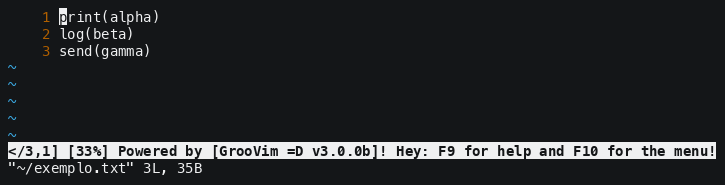
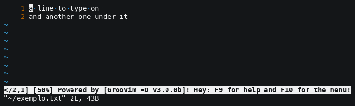
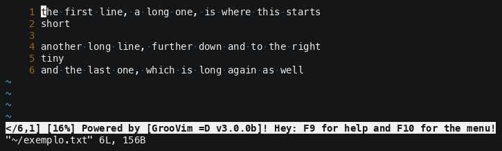
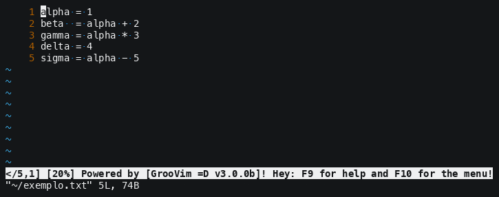
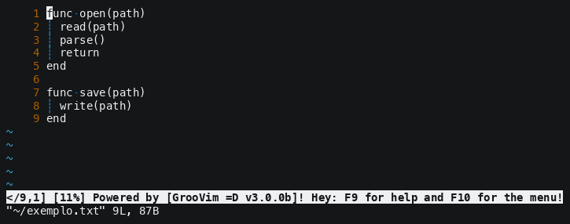
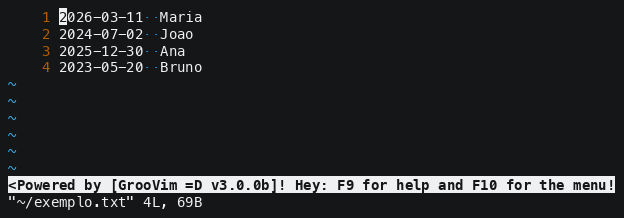
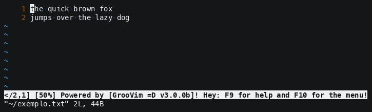
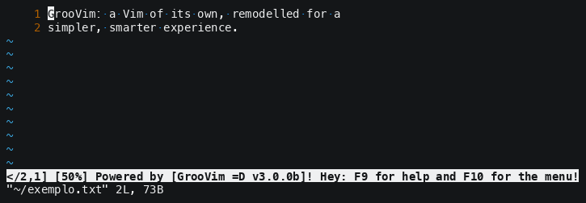

GrooVim - Vi IMproved'n'GrooVIed!
=============

**Guess who's back? Back again!** 😁


Writing in several places at once -- **F2 n** takes whole lines, **F2 m** takes
places of their own:



There are more of them below and all of them in [`demos/`](demos/README.md).

**NOTE:** They are made by a script and not recorded by hand -- change the editor, run
`./tools/make-demos.sh`, and they say what it says now. ☺️

Table of Contents
-----

- [What is GrooVim?](#what-is-groovim)
- [Before you start!](#before-you-start)
- [The keys you already know!](#the-keys-you-already-know)
- [What GrooVim adds!](#what-groovim-adds)
- [The questions GrooVim asks!](#the-questions-groovim-asks)
- [The file you have open!](#the-file-you-have-open)
- [Indentation!](#indentation)
- [Moving, marking and ordering!](#moving-marking-and-ordering)
- [The F keys (CommandZ)!](#the-f-keys-commandz)
- [Is it working?](#is-it-working)
- [If you liked it, consider helping the project!](#if-you-liked-it-consider-helping-the-project)
- [How GrooVim is installed!](#how-groovim-is-installed)
   * [Editing files of the system](#editing-files-of-the-system)
   * [About the clipboard](#about-the-clipboard)
   * [A Vim of its own](#a-vim-of-its-own)
- [Install GrooVim and start using it now!](#installGrooVim)
- [About](#about)

What is GrooVim?
-----

GrooVim is an extensive script -- a `.vimrc` and the parts it loads -- that
remodels Vim into a simpler, more intuitive and more productive editor. What it
is after:

 * Usable right away by whoever comes from an editor or an IDE;
 * A real interface -- a menu, screens that ask, panels, a bar that answers;
 * Vim as a general purpose editor, for people who do not live in the terminal;
 * Free software (GNU GPL v3.0 or later), open and community-supported;
 * At home where only a terminal exists: a server, an SSH, a machine with no desktop.

In a hurry? <a href="#installGrooVim">**Install it and start using it now**</a>.

This file says what GrooVim **can do**. **F9** opens the help inside it, which
says **how**: every screen, every answer, the whole list of shortcuts and the
name of every setting. The list of shortcuts in the two is written from the same
place, and a test refuses to pass while they disagree.

Before you start!
-----

**IMPORTANT I!** If you do not know how Vim works, open a terminal, run
__vimtutor__ and do the exercises -- 25 to 30 minutes. GrooVim does not replace
the Vim underneath it, it sits on top, so knowing Vim in its basics is what lets
you use this one well -- and contribute to it.

**IMPORTANT II!** Everything here was possible because of the Vim API. The
editor you are using is Vim; what GrooVim adds is how it answers you.

 * The shortcuts may clash with the ones of YOUR system. A terminal cannot carry
   every combination, so when there is a clash it is easier to move the one of
   the system;
 * Three plugins are used when they are installed, and GrooVim works without any
   of them -- [NERDTree](https://github.com/preservim/nerdtree), the file tree;
   [tcomment](https://github.com/tomtom/tcomment_vim), which comments lines;
   [move](https://github.com/matze/vim-move), which moves a line or a selection.
   Each one is detected: what is missing stays quiet, and a shortcut that needs
   it says which plugin is missing instead of failing.

The keys you already know!
-----

These do in GrooVim what they do in any editor:

 * **Ctrl-Left**/**Ctrl-Right** - a word at a time *(normal mode/insert/visual)*;
 * **Tab** - indents, and over a selection it indents every line of it *(normal mode/visual)*;
 * **Enter**, **Backspace**, **Del** and **Space** - where Vim gave them another meaning *(normal mode/visual)*;
 * **Ctrl-c** and **Ctrl-x** - copy and cut, through the system clipboard *(visual)*, and **Ctrl-v** pastes *(normal mode/insert/visual)*. A Del, an `x` or a replacement does **not** touch it: what you copied is still there after you delete something;
 * **Ctrl-u** and **Ctrl-r** - undo and redo *(normal mode/insert/visual)*;
 * **PageDown**/**PageUp**, the mouse wheel and a click - and they reach the places with no text on them: a short line, the gap after the end of one *(normal mode/insert/visual)*;
 * **Alt-.**/**Alt-,** - one key walks to the next/previous window, going round *(normal mode/insert/visual)*. Ctrl-w stays the key of Vim, which every window command begins with.

What GrooVim adds!
-----

Vim is not turned into another editor here: what changes is how it **answers**.
The keys an editor user already has in their fingers do what they do everywhere,
what an editor has and Vim has not is built on top, and what Vim does that
surprises a newcomer is moved out of the way. That is most of the work, and this
is some of it:

 * **Shift-Up** and **Shift-Down** walk in and out of insert and of the
   selection, and the cursor stays where it is *(normal mode/insert/visual)*:



 * **Alt-Right**/**Alt-Left** take a word at a time and **Alt-End**/**Alt-Home**
   the rest of the line. How much is selected is on the bar at the bottom while
   you hold it: `[46,3]` is 46 characters -- not bytes, so an accented letter
   counts as one -- lying on 3 lines;
 * The clipboard is the one of your system, with
   <a href="#clipboard">**nothing to install**</a>, and it works over SSH too;
 * **F2 b** opens the block selection, because **Ctrl-v** is the paste. **Ctrl-b**
   walks from one bracket to the one that closes it -- `(` to `)`, `[` to `]`,
   `{` to `}` -- and takes the selection with it;
 * What you type and what you paste land where the cursor is, which is where you
   put it;
 * Extensions Vim does not know are given a type: an `.inc` opens as HTML and a
   `.gds` as Visual Basic, and the list is yours to change;
 * With the plugins installed: **Ctrl-j**/**Ctrl-k** move the line or the
   selection, **Alt-Up** comments it and uncomments it, **F4 n** opens the file
   tree -- the same one in every tab.

The questions GrooVim asks!
-----

GrooVim asks instead of refusing, and every screen of it is answered the same
way:

 * **Esc** gives the question up, at any point, and nothing is done. **Ctrl-c**
   does the same, and it is also what stops a long movement;
 * An empty answer is not the same as giving up: on most screens it means "leave
   this one alone", and the question says so when it does;
 * Every screen ends asking whether to KEEP what you chose for the next time.
   Saying no changes this session and nothing on disk.

**F5 c** opens the settings -- all of them -- and one letter picks the screen:
`[i]`ndent, `[v]`iew, `[f]`ile, `[s]`earch, `[r]`eplace, `[t]`ools, `[g]`eneral.

The file you have open!
-----

The encoding and what ends a line belong to the **document**, not to the editor,
and both are asked on one screen -- **F5 c** and then `[f]`: `[a]`nsi, `[u]`tf-8,
utf-8 with `[b]`om, utf-16 `[l]`e or `[e]`b, and whether to **read** the file
again with that encoding -- the bytes do not move and their meaning changes -- or
to **convert** it -- the text does not move and the bytes do. What ends a line is
`[u]`nix, `[w]`indows or `[m]`acintosh. What the file is on right now is on the
bar at the bottom: `[utf-8,unix]`, with a `,B` when there is a BOM.

The **language** -- the colours, the indenting, the comment character -- is one
screen over, with `[v]`, and Tab completes among the hundreds Vim ships.

A file **deleted** from the disk while it is open asks whether to keep it here:
yes brings the document back as one with changes in it, so one save puts the file
on disk again; no lets it go with the file. Saving over a file that already
exists asks before writing over it, and closing a document with changes in it
asks what to do with them. Nothing of yours is ever lost to an error message.

Indentation!
-----

The indent is **2 columns wide and made of spaces**, with guides drawing the
levels, a dot on every space and an arrow on every tab -- a space and a tab look
the same and are not, and that is the kind of thing you want to see. The width
and whether Tab puts spaces are asked with **F5 c** and then `[i]`; what the
screen SHOWS -- the guides, the symbols, the mark of a long line, the word wrap
-- is one screen over, with `[v]`.

Only the file types you choose are touched. Vim already ships file type plugins
that know what they are doing, and some of them are not a matter of taste:
**make** needs a REAL tab on its recipe lines and **go** is written with tabs by
gofmt. Those are left alone. The guides read the width that is really in force,
so they follow a `modeline` or a file type plugin without being told.

Moving, marking and ordering!
-----

 * **Shift-Alt-Arrows** glide instead of jumping, go over the places where there
   is no text -- a short line, the gap after the end of one -- and keep the
   column they started in. **Ctrl-Alt-Arrows** do the same, one short step at a
   time *(normal mode/insert/visual)*:



 * **Alt-i**/**Alt-o** go BACK to where you came from and forward again: a
   search, a `G`, a line opened from the occurrence list, another file;
 * **Ctrl-Up**/**Ctrl-Down** walk the tabs, **Ctrl-Shift-Up**/**Ctrl-Shift-Down**
   carry the one you are on along the line, and **F5 t** pins a tab so that
   **Alt-Down** goes back to it from wherever you are;
 * A new tab is born at the **end** of the line, wherever you were when you asked
   for it. A file already open is **not opened again** -- you land on the tab that
   has it -- and two tabs with the same file name show the piece of the path that
   tells them apart. With more tabs than the line is wide it scrolls, and the one
   you are on is always drawn whole;
 * The **path** of the file is on the bar, with your home as `~` and the middle
   taken out when it does not fit; **F2 Space** says the whole of it in a balloon;
 * **F5 p** opens a file by name, in a tab of its own: the same question the
   saving asks, so a name lands in the folder you are in and a name with a path
   in front of it lands where the path says, with **Tab** completing as you go.
   A file that is **not there** is asked about instead of being opened under the
   name you typed;
 * A file handed from **another terminal** opens in the GrooVim you already have
   open, in a tab of its own, instead of starting a second one:

```
groovim -j README.md        # "just reuse an instance" (also: --jrinst)
```

   The oldest GrooVim still open takes it, and with none open that same command
   opens the file itself. It asks for no X and no desktop, so it works over SSH
   as well;
 * **F3 m** marks every occurrence of the word under the cursor. **F3 f** finds,
   offering that word, and with the list switched on every line it is in comes up
   in a panel of its own, where Enter goes there:



 * **n** and **N** walk what was found; **m** and **M** walk the marked lines;
 * **F4 b** marks a line and the mark shows in the margin, **F4 i** writes a note
   on it, and **F4 l** lists every one of them:



 * **F2 o** puts the **selected** lines in order. Whether the case counts, which
   way it climbs and whether only the unique lines come out are asked on **F5 c**
   and then `[t]`. To order by a **field** instead of by the whole line, select a
   **block** over the column that field begins at -- the comparison starts there,
   and what is to the left of it comes along. The result comes back selected,
   ready for the next thing you want to do to it:



The F keys (CommandZ)!
-----

A shortcut is an **F key** and then one more key: **F2**, **F3**, **F4** or
**F5**, and then the letter. It is what gives GrooVim room for many shortcuts in
a terminal, where the combinations a keyboard can send run out fast. Press an F
key and nothing after it and it repeats the last command THAT key ran -- one
memory each, so a command of another group can never come out of this one.

<!-- shortcuts: written by tools/sync-readme.sh, do not edit by hand -->

 * **File** *(The file itself: saving it, opening another, leaving)*

    - `F2->p` - Copies to the clipboard the name or path and name of the current buffer/file *(normal mode/insert/visual)*;
    - `F2->Space` - Says the WHOLE path of the file you are on, in a balloon *(normal mode/insert/visual)*;
        - The bar at the bottom shows as much of the path as can be read and this says all of it. The balloon goes down on the cursor moving or on <Esc> , and nothing it covers is lost -- you go on typing with it up;
        - It stands in the MIDDLE of the screen, in every mode: where the file IS has nothing to do with the line you are on, and over that line it would be in the way of the text;
        - From VISUAL mode what you had selected is still selected afterwards;
    - `F2->y` - Save to disk and open in a new tab a copy of the current file *(normal mode/insert/visual)*;
    - `F5->s` - Save to disk *(normal mode/insert/visual)*;
        - A document with no name yet is asked where to go, the way F5->a asks;
    - `F5->e` - Save every changed file *(normal mode/insert/visual)*;
    - `F5->a` - Saves under another name and goes on editing THAT one *(normal mode/insert/visual)*;
        - Beside F5->s , which saves, and F5->e , which saves every changed file. The COPY is F2->y : that one writes the file and leaves you where you were;
        - One question, and the name of the file you are on comes written in it: a NAME lands in the folder you are in, which the question names, and a name with a PATH in front of it lands where the path says. <Tab> completes paths;
        - A file that is already there is asked about before it is written over, and a no asks for the name again;
    - `F5->p` - Opens a file by name, in a tab of its own *(normal mode/insert/visual)*;
        - The same question F5->a asks: a NAME lands in the folder you are in, which the question names, and a name with a PATH in front of it lands where the path says. <Tab> completes paths;
        - A file that is NOT there is asked about instead of being opened -- Vim opens a document under any name you type and says nothing, so a path with one letter wrong came up as an empty tab wearing the name of the file you meant. Yes starts it anyway;
        - The tab is born at the END of the line, and a file already open is not opened twice: you land on the tab that has it;
    - `F5->n` - Open a new tab *(normal mode/insert/visual)*;
        - A document you have not saved yet is called new 1 , new 2 ... It is a name on SCREEN only -- the buffer stays nameless, so saving it asks you where to put it instead of writing a file called "new 1" wherever you happen to be;
        - The new tab goes to the END of the tab line, and the number is the LOWEST one nobody is using: close new 2 of new 1 , new 2 , new 3 and the next one is new 2 again;
    - `F5->q` - Close the window *(normal mode/insert/visual)*;
    - `F5->w` - Close the tab you are in *(normal mode/insert/visual)*;
        - On the LAST tab Vim refuses to close it, so what closes is the document, leaving an empty new 1 behind;
        - Changes you would lose are asked about, by every way of closing: Save "teste.txt" , yes or no, and <Esc> closes nothing. A document never saved is asked WHERE to put it next, the way F5->a asks;
    - `F5->o` - Close all other tabs *(normal mode/insert/visual)*;
    - `F5->.` - Close every tab to the RIGHT of this one *(normal mode/insert/visual)*;
    - `F5->,` - Close every tab to the LEFT of this one *(normal mode/insert/visual)*;
        - The keys of <<> and <>> without the Shift: the comma is to the left of the dot, which is the way each one closes;
    - `F5->x` - Close everything and leave *(normal mode/insert/visual)*;
        - Every way of closing ASKS about unsaved text: save, throw away, or go back;
    - `F5->[` - Saves the current session *(normal mode/insert/visual)*;
    - `F5->]` - Brings the last saved session back *(normal mode/insert/visual)*;
        - The session saves itself when you leave and comes back when you open GrooVim with NO file. While that is on, <[> and <]> say so instead of pretending to work. Turn it off with F5->c;

 * **Edit** *(Changing the text: the transfer area, undo, the indent, the case)*

    - `F2->o` - Sorts the lines you have selected *(normal mode/insert/visual)*;
        - Asked on F5->c and then [t] : case [s] ensitive or [i] nsensitive, [a] scending or [d] escending, and whether only the UNIQUE lines come out -- which they do unless you say otherwise;
        - By a FIELD and not by the whole line: select a BLOCK with F2->b over the column the field begins at, then press this. Ordering xx-3 , yy-1 , zz-2 from the fourth column gives yy-1 , zz-2 , xx-3;
        - The RESULT comes back selected, with the cursor on the end of its last line, ready for one more thing to be done to the whole of it;
    - `F2->h` - Aligns to left *(normal mode/insert/visual)*;
    - `F2->k` - Aligns to right *(normal mode/insert/visual)*;
    - `F2->j` - Aligns to center *(normal mode/insert/visual)*;
    - `F2->Up` - Changes to uppercase *(normal mode/insert/visual)*;
    - `F2->Down` - Changes to lowercase *(normal mode/insert/visual)*;
    - `F2->t` - Title Case: the first letter of every word up, the rest down *(normal mode/insert/visual)*;
        - In normal and insert mode it is the word under the cursor; in visual mode, every word of the selection and nothing outside it. An apostrophe ENDS a word, so "don't" becomes "Don'T";
        - The three of them leave the cursor where it was;
    - `F2->c` - Copy all text in the current buffer *(normal mode/insert/visual)*;
    - `F2->q` - Start and stop recording a macro *(normal mode/insert/visual)*;
        - The same F2->q does both: the first press starts the recording and says so, the second ends it. It used to take a key of its own;
        - What is recorded goes into the register a , and F2->w runs it. The F2->q that ends the recording is cut off the register, so playing it back does not start another one;
    - `F2->w` - Run a macro *(normal mode/insert/visual)*;
    - `F2->e` - Run a macro certain number of times or repeatedly until the last line *(normal mode/insert/visual)*;
    - `F3->l` - Takes the line away, without touching the transfer area *(normal mode/insert/visual)*;
    - `F3->d` - Duplicates the current line/selection *(normal mode/insert/visual)*;
        - If in the visual mode can not be replicated;
    - `Ctrl+C` - Copies what is selected, and leaves the cursor where it was *(visual)*;
    - `Ctrl+X` - Cuts what is selected *(visual)*;
    - `Ctrl+V` - Pastes what is in the transfer area *(normal mode/insert/visual)*;
    - `Ctrl+U` - Undoes the last change *(normal mode/insert/visual)*;
    - `Ctrl+R` - Does again what was undone *(normal mode/insert/visual)*;
    - `F2->n` - Writes on several lines at once: it goes straight into insert, and the arrows take in the lines above and below *(normal mode)*;
        - The line you started on is the anchor and does not move: Down and Up move the OTHER end, so three down and one up leaves two lines taken;
        - Everything else happens in every caret, each one where IT is: what you type, the Enter that cuts its own line, the Tab that fills to the next stop of its own column, the Del , the Backspace -- and End , which is the end of each line, on lines of any length;
        - A line too short to reach the column takes the text at ITS end, so no line is left out;
        - Esc ends it;
    - `F2->m` - Marks one more place to write in, and opens for writing at once: walk to the next place and press it again, or just type *(normal mode/insert)*;
        - Beside F2->n , which takes whole lines. This one is for places that have nothing to do with each other;
        - While you are still CHOOSING nothing is written and the carets are ORANGE, the colour of typing: the plain arrows walk you to the next place and leave them where they are;
        - Esc sets the places and turns them YELLOW: from there everything you do happens in all of them -- what you type, the Enter , the Del , the Tab , the Backspace -- and everything that moves moves EVERY caret, each one from where IT is;
        - Esc again ends it. One key for both, because it is the same thing said twice: done choosing, then done writing;
    - `Shift+Up` - Goes into insert and comes out of it: from normal or from a selection it starts typing, and from insert it stops *(normal mode/insert/visual)*;
        - The pair of Shift+Down : one walks towards typing, the other towards selecting, and either walks back;
    - `Shift+Down` - Goes into the selection and comes out of it: from normal or from insert it starts selecting, and from a selection it stops *(normal mode/insert/visual)*;
    - `Alt+Up` - Comments the line, or the selection, and uncomments it *(normal mode/insert/visual)*;
    - `Ctrl+K` - Moves a line up, or every line of the selection *(normal mode/insert/visual)*;
    - `Ctrl+J` - Moves a line down, or every line of the selection *(normal mode/insert/visual)*;

 * **Select** *(Taking hold of text: all of it, a block, a word, an area)*

    - `F2->b` - Selects a BLOCK: a rectangle of the text, corner to corner *(normal mode/insert/visual)*;
    - `F3->a` - Select all text in the current buffer *(normal mode/insert/visual)*;
    - `Alt+Left` - Selects the word to the left *(normal mode/insert/visual)*;
    - `Alt+Right` - Selects the word to the right *(normal mode/insert/visual)*;
    - `Alt+Home` - Selects back to the start of the line *(normal mode/insert)*;
    - `Alt+End` - Selects on to the end of the line *(normal mode/insert)*;

 * **Search** *(Finding and replacing, and the marks a search leaves)*

    - `F3->/` - Takes every highlight off the text *(normal mode/insert/visual)*;
        - The search highlight AND the marks of F3->m : taking the highlighting off is one idea to a reader and not two, and having to remember which key clears which half would be a poor way of saying so;
    - `F3->m` - Mark every occurrence of the word under the cursor *(normal mode/insert/visual)*;
        - It is the WORD the cursor is ON, and a selection changes nothing. A cursor over a space marks nothing: the word NEXT to it is not the word it is on. Pressing it again on the same word takes the marks down, and so does </>;
        - It does not move the cursor and does not touch what <n> would find next: you can mark a name and go on searching for something else;
    - `F3->f` - Opens for search *(normal mode/insert/visual)*;
    - `F3->h` - Opens to replace *(normal mode/insert/visual)*;
        - The replace begins at the CURSOR. WITH confirmation, having reached the end of the file it continues from the top if occurrences were left behind, and says so. Without confirmation it does only what it says, from the cursor down. Configure it with F5->c and then [r];
    - `n` - Goes to the next of what was searched for *(normal mode)*;
    - `N` - Goes to the one before it *(normal mode)*;

 * **Move** *(Walking the text: the smooth movement, the pages, the brackets)*

    - `Alt+Shift+Up` - Walks up, smoothly, and takes the selection along *(normal mode/insert/visual)*;
    - `Alt+Shift+Down` - Walks down the same way *(normal mode/insert/visual)*;
    - `Alt+Shift+Left` - Walks left the same way *(normal mode/insert/visual)*;
    - `Alt+Shift+Right` - Walks right the same way *(normal mode/insert/visual)*;
    - `Ctrl+Alt+Up` - One step up, over areas with no text *(normal mode/insert/visual)*;
    - `Ctrl+Alt+Down` - One step down, the same *(normal mode/insert/visual)*;
    - `Ctrl+Alt+Left` - One step left, the same *(normal mode/insert/visual)*;
    - `Ctrl+Alt+Right` - One step right, the same *(normal mode/insert/visual)*;
    - `Ctrl+Left` - A word back *(normal mode/insert/visual)*;
    - `Ctrl+Right` - A word forward *(normal mode/insert/visual)*;
    - `Ctrl+B` - From one bracket to the one that closes it, and back *(normal mode/insert/visual)*;
    - `Alt+I` - To the place you were before the jump, and the one before that *(normal mode/insert/visual)*;
        - A JUMP and not a step: what a search, a G , an occurrence of the list or opening another file left behind. Walking with the arrows leaves nothing to come back to, which is what you want -- it is the jumplist of Vim;
        - It is kept per WINDOW, so each window remembers its own way back;
    - `Alt+O` - Undoes the going back, up to where you first pressed it *(normal mode/insert/visual)*;

 * **View** *(What is beside the text: the tree, the marked lines, the tabs, the help)*

    - `F4->n` - Opens/closes the file tree *(normal mode/insert/visual)*;
        - Asked for once, the tree is in EVERY tab, including the ones opened afterwards: it is a dock, like the search list and the list of marked lines. Pressing it again takes it from every tab;
        - In the tree, Enter opens the file in a TAB OF ITS OWN and leaves the one you were reading where it was. A file already open is jumped to instead of opened again, and a folder simply unfolds;
    - `F4->b` - Marks the line, or takes the mark off ( bookmark ) *(normal mode/insert/visual)*;
    - `F4->i` - Writes a note on the marked line, or changes it ( bookmark ) *(normal mode/insert/visual)*;
    - `F4->l` - Lists every marked line, or takes the list away *(normal mode/insert/visual)*;
        - In the list, Enter or a double click takes you to the line, and Del takes that mark off -- which is what the key means in a list everywhere else;
    - `F4->c` - Takes every mark off EVERY file, and asks first *(normal mode/insert/visual)*;
    - `m` - To the next marked line *(normal mode)*;
    - `M` - To the marked line before it *(normal mode)*;
    - `Ctrl+Up` - The next tab *(normal mode/insert/visual)*;
    - `Ctrl+Down` - The tab before it *(normal mode/insert/visual)*;
    - `Ctrl+Shift+Up` - Moves this tab one place to the right *(normal mode/insert/visual)*;
    - `Ctrl+Shift+Down` - Moves it one place to the left *(normal mode/insert/visual)*;
    - `F5->t` - Allows always returning to a particular tab using <Alt-Down> *(normal mode/insert/visual)*;
        - The pinned tab wears a mark on the tab line, so which one it is can be seen at any moment without pressing anything. The mark is g:GrooVim_TabPinMark , and "" takes it off;
        - Pressed ON the pinned tab it unpins; pressed anywhere else it moves the pin there. One tab at a time, because "take me back" has to mean one place;
        - The pin lives IN the tab and not in its number: carrying the tab along the line with Ctrl+Shift+Up takes the pin with it;
    - `Alt+Down` - Back to the tab set with F5->t *(normal mode/insert/visual)*;
        - Pressed ON the pinned tab it does the opposite: back to the tab you came from. With no tab pinned it is always that -- the last one you were on;
    - `Alt+,` - To the window before this one, going round *(normal mode/insert/visual)*;
        - It was Ctrl+W , which only ever went one way. And the Ctrl+W of Vim is back to being what it is everywhere else: the key every window command begins with;
    - `Alt+.` - To the next window, going round *(normal mode/insert/visual)*;
    - `F10` - Opens this menu *(normal mode/insert/visual)*;

 * **Settings** *(What GrooVim is: every setting, and reading it again)*

    - `F5->r` - Reloads the file .vimrc in all tabs *(normal mode/insert/visual)*;
    - `F5->c` - Opens the settings -- ALL of them *(normal mode/insert/visual)*;
        - It asks which of them first: [i]ndent , the width and what <Tab> puts; [v]iew , what is DRAWN and is not in the file, the language among it; [f]ile , the encoding and what ends a line IN the file you have open; [s]earch ; [r]eplace ; [g]eneral . Then it opens that screen;
        - [i] asks the width of the indent and whether <Tab> puts spaces; [v] asks what the screen SHOWS -- the guides, the symbols, the long-line mark, the word wrap;
        - On every screen, leaving an answer EMPTY keeps the value shown as "in use". At the end a summary of what you chose is held on screen until you press <Enter>;
        - [f]ile is the only one with nothing to save: an encoding belongs to the DOCUMENT and not to GrooVim, so it applies to what is open and stops there;
        - There is one door and only one. Each screen used to have a key of its own, so the letters f , h and i of this group are free again;

 * **?** *(The help of GrooVim, the help of Vim, and what this is)*

    - `F9` - Opens the help of GrooVim, and closes it *(normal mode)*;
    - `F1` - Opens the help of Vim itself *(normal mode/insert)*;
        - It is the <F1> of Vim and nothing of GrooVim: no mapping of ours stands in front of it. On a Vim file, K over a word opens the help OF THAT WORD, which is what the keywordprg of Vim is for;
        - In visual mode it does nothing -- measured, and it is Vim: <Help> is not a visual mode command;
    - `F5->/` - What GrooVim is: the version, the licence, and the Vim underneath *(normal mode/insert/visual)*;
        - It is a DIALOGUE, and every dialogue of GrooVim is answered the same way: <Left> and <Right> walk the buttons, <Enter> presses the blue one, the letter beside a label presses that one, and the mouse clicks any of them;
        - c copies what a dialogue says -- this one and every other -- which is why there is no button for it;
        - An address in a dialogue is a link: click it and it opens where you open a page. With no desktop, which is every GrooVim reached over SSH, the address goes to the clipboard instead, and the clipboard travels through the terminal to the machine you are sitting at;
        - The same F5->/ closes it, and so does the way out on it;

<!-- shortcuts: end -->

You do not have to remember any of them: **F10** puts a bar across the top with
the sections above on it, and under the one you are on, what it holds. Left and
Right walk the bar, Up and Down the list, Enter picks and Esc leaves, and an F
key jumps straight to the section that F key lives in. The mouse works
everywhere. Every line shows the keys that do it, and choosing one presses those
keys -- so the menu can never do anything the keyboard would not.



The windows that ask something look like this one, which is the About of the
"?" section. The arrows walk the buttons, Enter presses the blue one, the mouse
clicks them, `c` copies what the window says -- any window -- and an address in
it is a link:



Is it working?
-----

GrooVim has a battery of tests that runs on its own, and it is not only for
whoever writes it: it is how you find out whether the GrooVim **on your machine**
does what this file says it does.

```
./tests/run.sh             from the project
~/.groovim/tests/run.sh    the copy install.sh leaves beside your installation,
                           which tests that one and needs no argument
```

It opens a real Vim for each case, presses real keys and reads what happened --
the occurrence list, the tabs, the replace, the session, the menu, the multiple
carets, the dialogues. **36 cases, over a thousand checks, about half a minute**,
and it exits `0` only when the last line says everything passed. A check that
fails says `FAILED` beside it, with what was read in brackets.

Beside it, `./tools/lint.py` reads the source itself -- the header every part
opens with, the notes, the width of the lines -- and `--fix` puts them back in
shape.

[`docs/pitfalls.md`](docs/pitfalls.md) says what each case covers and carries the
traps that cost the most to find.

If you liked it, consider helping the project!
-----

 * We need people to keep good documentation.
 * We need people to test.
 * Of course! We need people __to develop__ and __fix bugs__!

<a name="buildInstallVIM"></a>
How GrooVim is installed!
-----

One command, from a checkout of this repository:

```
./install.sh
groovim file.txt
```

It builds a Vim of its own, installs GrooVim into `~/.groovim`, and writes a
`groovim` command that reaches the two. Run it again whenever you like: it builds
the Vim only when the one it finds does not serve, so a second run costs nothing.
`./install.sh --help` lists where each thing goes and how to build a particular
version of Vim.

**The Vim of your system is not touched and is not used.** GrooVim is reached
through `groovim` and runs on the Vim this script builds; your `vim` stays
exactly as it was, with its own configuration and its own plugins. [Why a Vim of
its own](#ownVim).

### Editing files of the system

```
sudo groovim /etc/hosts
```

`sudo` replaces your `PATH` with the `secure_path` of the sudoers file, and a
directory of yours is not in it -- so `sudo groovim` answers "command not found"
until the command is reachable from a directory that IS. `install.sh` offers to
link it into `/usr/local/bin` for you, and you can always do it by hand:

```
sudo ln -s ~/.local/bin/groovim /usr/local/bin/groovim
```

Under `sudo`, GrooVim reads the one installation -- the same code, the same
plugins, the same saved options -- and writes what it leaves behind (the session,
the undo, the `viminfo`) into a directory of whoever is running, so nothing in
your home ends up owned by root.

<a name="clipboard"></a>
### About the clipboard

**There is nothing to install.** GrooVim reaches the clipboard through a cascade
and uses the first of these that answers: Wayland, X11, a clipboard tool that is
already there, OSC 52 -- an escape sequence that carries the clipboard through
the terminal, so a copy made on a server lands on the machine in front of you --
and, last, a file of its own, which always works and lets two GrooVim share a
copy.

Copying **out** always works, wherever you are. **Pasting what another
application copied** is the one case that can need help: where neither Wayland
nor X11 answers -- an SSH, a container, a machine with no desktop -- `Ctrl-v`
pastes what GrooVim itself copied, and the paste of your terminal (usually
`Ctrl-Shift-v`) brings in what came from outside. Installing a clipboard tool
(`wl-clipboard`, `xclip`, `xsel`) brings `Ctrl-v` back to the system clipboard
with nothing to change in your configuration, and `install.sh` says at the end
which of these cases you are in.

**F9** tells the rest: how to see which of the five is in use, and why no binary
is shipped with GrooVim.

<a name="ownVim"></a>
### A Vim of its own

`install.sh` builds a Vim for GrooVim alone and writes a `groovim` command that
runs it.

**GrooVim asks for Vim 9.2 or newer** and builds the newest 9.x release it finds.
It depends on what arrived in 9.2 -- the clipboard providers among it -- so the
number is decided at install time and `install.sh` refuses to go on below it.
Nothing checks it while you type, because by then you are already running the Vim
that was built for this.

The two never share anything:

| | `vim` | `groovim` |
|---|---|---|
| binary | the one of your distribution | `~/.local/share/groovim/bin/vim` |
| configuration | your `~/.vimrc` | the `.vimrc` of GrooVim |
| plugins | `~/.vim` | `~/.groovim` |
| `viminfo` | `~/.viminfo` | `~/.groovim/viminfo` |

GrooVim keeps its own directory, `~/.groovim`, and that is where its plugins, its
saved options, its undo history and its `viminfo` live. `~/.vim` is not in its
path and never is read: what belongs to GrooVim is GrooVim's alone, and what
belongs to your Vim stays yours. That directory can be moved as a whole, which
makes two GrooVim that know nothing of each other on one machine -- **F9** says
how.

<a name="installGrooVim"></a>
Install GrooVim and start using it now!
-----

```
git clone https://github.com/eduardolucioac/groovim.git
cd groovim
./install.sh
groovim file.txt
```

It installs the build dependencies of your distribution (`pacman`, `apt-get`,
`apt`, `dnf` and `zypper` are known, and it asks before running anything as
root), builds the Vim and puts everything in place. Tested on Debian, Ubuntu,
Fedora, Rocky, Arch and openSUSE -- `./tests/distros.sh` builds a throwaway
machine of each and runs it.

That is the whole installation. What it leaves on your machine:

| where | what |
|---|---|
| `~/.local/share/groovim` | the Vim it built, used by nothing else |
| `~/.groovim` | GrooVim itself, its plugins, its session, its saved options |
| `~/.local/bin/groovim` | the command that runs the one on the other |

The checkout is not needed afterwards -- everything is **copied**, so you can move
it or throw it away. To update, pull and run `./install.sh` again.

The three plugins GrooVim knows how to drive -- **NERDTree**, **tcomment_vim**
and **vim-move** -- go in with it, each on a **release** and not on whatever its
default branch is that day: the series is pinned and the newest release inside it
is the one taken, the same rule the Vim is built by. A fix arrives on its own, a
new major does not arrive behind your back, and a machine installed today and one
installed next year get the same editor. Running `./install.sh` again updates
them; `--no-plugins` leaves them out.

Nothing GrooVim promises rests on one: each is detected, and a shortcut whose
plugin is not there says which one is missing instead of failing. Putting one in
by hand, or one of your own, needs no plugin manager -- **F9** says where they
live and how to turn one off.

About
-----

GrooVim 🄯 GNU GPL v3.0 or later  
Eduardo Lúcio Amorim Costa  
Brazil-ES  
https://www.linkedin.com/in/eduardo-software-livre/  


